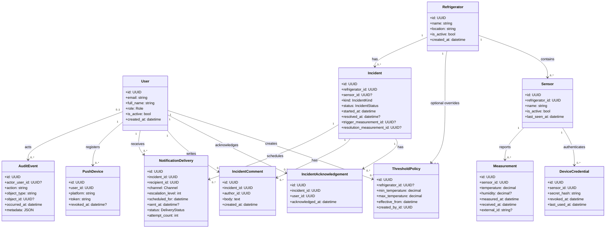

# Backend architecture proposal

**Status:** Proposal for discussion
**Scope:** Django backend for Cold Chain Monitoring
**Source:** `temp/Cahier des charges - Cold Chain Monitoring.pdf`

This is a target design, not a claim about the current implementation. The repository currently contains a small Django/DRF prototype; this proposal evolves it into a backend that can identify multiple refrigerators and sensors, enforce user and device permissions, create incidents, and schedule notifications reliably.

## 1. Backend responsibilities

- Receive and validate temperature/humidity measurements from sensors.
- Persist every accepted measurement and associate it with a refrigerator and sensor.
- Resolve the effective allowed temperature range (global default with optional refrigerator override) and create or resolve incidents.
- Provide authenticated APIs for the web frontend and the minimal native mobile app.
- Schedule, send, retry, and record notifications with escalation.
- Enforce role-based permissions and maintain an append-only audit trail for meaningful actions.
- Provide filtered monitoring/history data and CSV exports.

The backend is the source of truth. Neither the mobile app nor a sensor decides whether an incident is open, who should be notified, or when escalation occurs.

## 2. Proposed Django structure

Keep a modular Django monolith for the first release. Separate apps by domain so the code remains easy to change without the operational burden of microservices.

```text
config/                 Django settings, root URLs, ASGI/WSGI
accounts/               custom user, roles, authentication, device push tokens
refrigerators/          refrigerators, sensors, threshold configuration
monitoring/             measurements, ingestion, incident detection/lifecycle
notifications/          delivery records, push/Telegram adapters, scheduled jobs
audit/                  append-only audit events
api/                    API versioning, shared pagination/error conventions
```

The repository currently calls its project package `projet` and its app `DHT`. These can be retained during an incremental implementation or renamed as a separate refactor; the domain boundaries above matter more than the exact Python package names.

## 3. Domain class diagram



`ThresholdPolicy.refrigerator_id = null` means the global policy. For a refrigerator, the most recent policy effective at the measurement time wins: refrigerator-specific first, otherwise global. Policies need an `effective_to` (or equivalent unambiguous version boundary) so a policy can be evaluated for historical readings; do not overwrite old policies. Ensure policy periods for the same scope do not overlap, define how a new policy takes effect (recommended: immediately at server time), and validate `min_temperature < max_temperature`. An active refrigerator must have an effective threshold before it accepts measurements; either require a global default before activation or reject ingestion with a recorded configuration error.

A threshold change is prospective: it does not rewrite past incidents or measurements. The next accepted, chronologically newer measurement evaluates against the policy effective at its sample time and may open or resolve an incident. This avoids resolving an incident solely because someone widened the threshold without receiving a new reading.

## 4. Model notes and invariants

- Use a custom Django `User` model from the beginning, keyed by unique email. Suggested roles: `ADMIN`, `OPERATOR_1`, `OPERATOR_2`, `OPERATOR_3`. Role authorization belongs in DRF permissions/services, not only in hidden frontend controls.
- Use UUID public identifiers for domain records. Store all timestamps in UTC; serialize ISO 8601 timestamps with timezone information.
- `Measurement.measured_at` is the sensor's claimed sample time; `received_at` is assigned by the server. Reject implausibly future timestamps and define a maximum accepted clock skew. Preserve both timestamps for diagnostics.
- Add a uniqueness constraint on `(sensor, external_id)` when a device can supply a stable message ID. If not, use an idempotency key at ingestion. Retries must not silently create duplicate samples.
- Process each accepted measurement and its incident transition in one database transaction. Serialize incident state changes per refrigerator (for example, lock the refrigerator row) and add a database constraint allowing at most one open incident per refrigerator and incident kind. This prevents simultaneous sensor posts from creating duplicate open incidents. If independent sensors in one refrigerator can create independently tracked temperature incidents, change the uniqueness scope and requirement accordingly.
- Define how delayed/out-of-order samples are handled. Recommended: persist valid delayed measurements for history, but only let a sample newer than the latest processed sample drive current incident state; otherwise a stale normal reading could close an incident triggered by a newer abnormal reading. If samples are processed by `measured_at`, define a bounded lateness window and recomputation policy.
- `Incident.kind` should distinguish at least `TEMPERATURE_OUT_OF_RANGE` and `SENSOR_SILENT`. `status` starts as `OPEN`, then transitions to `RESOLVED`. Acknowledgement is a separate record and does not close or pause the incident.
- Multiple acknowledgements may be useful to show which operators saw the incident and when; avoid a single mutable `acknowledged_by` field. Comments are separate immutable records.
- `NotificationDelivery` records every intended send, recipient, level, channel, scheduled time, provider result, retry, and failure. A unique key such as `(incident, recipient, channel, scheduled_for)` prevents duplicate sends after worker retries.
- Audit events should be append-only at the application level. Record actor (or system), action, object, timestamp, and carefully selected before/after metadata. Do not store passwords, tokens, or other secrets in the audit payload.
- Deactivate users, refrigerators, and sensors rather than deleting records referenced by measurements or audit events.

## 5. Incident and notification rules

### Temperature incident

1. On a newly accepted measurement, load the applicable threshold policy for its refrigerator and sample time. An idempotent retry does not run incident detection a second time.
2. If temperature is below minimum or above maximum, create an open temperature incident if one is not already open for the refrigerator and kind. Link the triggering measurement and record the effective threshold snapshot used for the decision. Enforce the single-open-incident invariant in the database as well as application logic.
3. If a later valid measurement is within range, resolve the matching open temperature incident and store the resolving measurement and timestamp.
4. Acknowledging an incident never changes this lifecycle and never stops reminders/escalation.

**Decision to confirm:** the brief says the incident is resolved when temperature returns within range. This proposal follows that rule with one in-range measurement. If noisy sensors cause rapid open/resolve cycles, add a separately agreed hysteresis or consecutive-normal-measurements rule rather than silently changing behavior.

### Escalation timeline

- Level 1 is eligible at incident start (`t=0`), level 2 at `t=1h`, and level 3 at `t=2h` while the incident remains open.
- Each reached level is reminded every 20 minutes while the incident remains open. Example: at `t=80m`, level 1 has sends due at 0, 20, 40, 60, 80 minutes; level 2 at 60 and 80 minutes.
- Acknowledgement is recorded, but does not suppress due notifications or escalation.
- If the incident resolves before a scheduled send, cancel/skip unsent deliveries. Already sent messages remain in the delivery history.
- Store explicit scheduled delivery rows (or an equivalent durable schedule) and make send jobs idempotent. Do not depend on an in-memory timer or a request process staying alive.
- Define a stable schedule anchor as `Incident.started_at`; due times are `started_at + level_offset + n * 20 minutes`, where `n >= 0` and `level_offset` is 0, 60, or 120 minutes. All times are UTC. If a worker is late, send only the most recent due reminder per level and mark older missed slots skipped; do not blast every missed historical reminder. Resume the normal cadence after that. The acceptance scenario assumes a healthy scheduler and should assert the stated counts at `t=80m` and `t=2h`.
- Snapshot each delivery's intended recipient, escalation level, and channel when scheduling it. A role change or user deactivation must not silently rewrite the audit history; define whether future unsent deliveries are canceled/reassigned when recipients change.
- Define recipient selection per role and deployment. If there are multiple users at a level, the default proposal is to notify every active user in that level; the brief does not specify this.
- If a push provider is temporarily unavailable, retry with bounded backoff and record each result. Telegram can be configured as a fallback channel. Provider failure must not erase the scheduled delivery record.

### Silent sensor

The brief marks this behavior as pending validation. If adopted, treat it as its own incident kind. Determine liveness from `last_seen_at` / the last accepted measurement and create one open silent-sensor incident after the agreed timeout (currently proposed as 40 minutes). Resolve it when a valid measurement arrives. Do not create repeated silent incidents for every scheduler tick.

## 6. API conventions

- Base path: `/api/v1/`.
- JSON request/response bodies, UTF-8, ISO 8601 datetimes, decimal values represented as JSON numbers.
- Use standard HTTP status codes and a consistent error shape, e.g. `{"detail":"...","code":"permission_denied"}`.
- Paginate list endpoints; default sort newest first where appropriate. Support explicit filters and bounded date ranges to avoid unbounded measurement queries.
- Require HTTPS outside local development. Browser sessions can use Django session auth and CSRF; mobile clients can use short-lived access tokens with refresh tokens. Sensor ingestion uses a separate device credential, not a human user token.
- Specify the token implementation and revocation behavior before implementation. If refresh-token rotation/revocation is required, persist token state or use a library that supports it; a stateless JWT logout endpoint alone cannot revoke an already-issued token. Human account creation must also define a password setup/reset or invitation flow rather than returning a generated password in the admin API.
- All user-facing writes should create audit events in the same database transaction as the change where possible.

## 7. Endpoint proposal

`{id}` values below are UUIDs. Unless labeled **device**, endpoints require an authenticated human user. Unless labeled **admin**, role checks still apply; the server must return `403` when the user lacks permission.

### Authentication and profile

| Method | Endpoint | Purpose / access |
| --- | --- | --- |
| POST | `/auth/token/` | Sign in and obtain access/refresh tokens for mobile; alternatively use Django session login for the web frontend. |
| POST | `/auth/token/refresh/` | Refresh a mobile access token. |
| POST | `/auth/logout/` | Revoke the current refresh token/session. |
| GET | `/users/me/` | Return current user identity and role. |
| GET | `/users/` | List users; **admin**. |
| POST | `/users/` | Create user; **admin**. |
| GET/PATCH | `/users/{id}/` | View/update user; **admin**, with restricted self-profile fields if desired. |
| POST | `/users/{id}/deactivate/` | Deactivate account without deleting history; **admin**. |

Creating a user must trigger a password setup/invitation flow. Never return or email a reusable generated password from this endpoint.

### Refrigerators, sensors, and thresholds

| Method | Endpoint | Purpose / access |
| --- | --- | --- |
| GET | `/refrigerators/` | List refrigerators visible to the user. |
| POST | `/refrigerators/` | Register refrigerator; **admin or level 3**. |
| GET | `/refrigerators/{id}/` | Refrigerator detail, current status, effective threshold, latest measurement. |
| PATCH | `/refrigerators/{id}/` | Update metadata/active state; **admin or level 3**. |
| GET/POST | `/refrigerators/{id}/sensors/` | List/register sensors; registration **admin or level 3**. |
| PATCH | `/sensors/{id}/` | Update metadata/active state; **admin or level 3**. |
| POST | `/sensors/{id}/credentials/rotate/` | Rotate device credential; **admin**. Return new secret once only. |
| GET | `/thresholds/` | List current and historical policies. |
| POST | `/thresholds/` | Create global or refrigerator-specific policy; **admin or level 3**. |
| GET | `/thresholds/{id}/` | View policy and author/effective period. |

### Device ingestion (sensor credential, not user JWT)

| Method | Endpoint | Purpose / access |
| --- | --- | --- |
| POST | `/ingest/measurements/` | Submit one measurement; authenticated sensor credential, sensor identity derived server-side. Accept `external_id`, `temperature`, `humidity`, and `measured_at`; return `201` for new, `200`/deduplicated result for a recognized retry. |

Do not trust a client-supplied refrigerator ID to authorize a write. Bind the device credential to one sensor/refrigerator. Require TLS, rate-limit by device, validate numeric bounds, and support key rotation and revocation. Consider request signing with timestamp/nonce if the device can support it.

During migration, `/api/post` accepts the historical `temp`/`hum` body as an adapter to this same service. It still requires `Authorization: Sensor <credential-id>.<secret>` and an `Idempotency-Key` header; retries must reuse the key. It stores into the new `Measurement` table. The old `/api/get` continues to read historical `Dht11` rows until a separate read API replaces it.

### Measurements and monitoring

| Method | Endpoint | Purpose / access |
| --- | --- | --- |
| GET | `/measurements/` | Query measurements by `refrigerator`, `sensor`, `from`, `to`; operators and above. Enforce a maximum date range/page size. |
| GET | `/measurements/latest/` | Latest accepted measurement and sample age per refrigerator/sensor. |
| GET | `/refrigerators/{id}/measurements/` | Measurement series for one refrigerator, date-filtered for charts. |
| GET | `/dashboard/summary/` | Counts of open incidents, refrigerator status, and latest readings for dashboard. |

### Incidents and operator actions

| Method | Endpoint | Purpose / access |
| --- | --- | --- |
| GET | `/incidents/` | List open incidents by default. Level 1/2 can see open incidents only; level 3/admin may query resolved history. Filter by `status`, `kind`, `refrigerator`, `from`, `to`. |
| GET | `/incidents/{id}/` | Incident detail including trigger/resolution data and threshold snapshot. Level 1/2 may access open incidents only; level 3/admin may access history. |
| GET | `/incidents/{id}/timeline/` | Chronological acknowledgements, comments, notifications, and state changes, with the same incident visibility rules. |
| POST | `/incidents/{id}/acknowledgements/` | Acknowledge an open incident; operator level 1/2/3 and admin. Not idempotent by default unless duplicate acknowledgement is explicitly defined. |
| POST | `/incidents/{id}/comments/` | Add a comment; operator level 1/2/3 and admin. |
| POST | `/incidents/{id}/resolve/` | **Not exposed for normal users** if resolution is based on sensor data. Reserve for a separately approved administrative correction workflow, with reason and audit event. |

### Notifications, audit, and exports

| Method | Endpoint | Purpose / access |
| --- | --- | --- |
| GET | `/notifications/` | Current user's delivery history/status. |
| POST | `/push-devices/` | Register or refresh the current user's mobile push token. |
| DELETE | `/push-devices/{id}/` | Revoke own push token. |
| GET | `/audit-events/` | Search audit history; **admin**, with scoped filters. |
| GET | `/exports/measurements.csv` | Export measurements by refrigerator/date filters; **level 3/admin**. |
| GET | `/exports/incidents.csv` | Export incidents by status/date/refrigerator filters; **level 3/admin**. |
| GET | `/health/live/` | Process liveness for orchestration; no sensitive data. |
| GET | `/health/ready/` | Readiness including database/queue connectivity; restrict detailed output. |

Legacy `/api/get` and `/api/post` can remain during device migration, but should call the same validation and domain services. Deprecate them once firmware uses `/api/v1/ingest/measurements/`.

## 8. Role and permission matrix

| Capability | Admin | Operator 1 | Operator 2 | Operator 3 |
| --- | --- | --- | --- | --- |
| View monitoring and open incidents | Yes | Yes | Yes | Yes |
| Acknowledge and comment | Yes | Yes | Yes | Yes |
| Receive escalation notifications | Optional/configured | From `t=0` | From `t=1h` | From `t=2h` |
| View historical incident/measurement data | Yes | No per brief | No per brief | Yes |
| Export CSV | Yes | No | No | Yes |
| Configure temperature thresholds | Yes | No | No | Yes |
| Manage users and roles | Yes | No | No | No (brief says primarily admin) |
| Register/edit refrigerators and sensors | Yes | No | No | Proposed yes; confirm with stakeholder |

Apply authorization on every API operation and object query. Hiding navigation items in the frontend is not authorization. Admin and level 3 are close but not interchangeable; user/role management remains admin-only.

## 9. Processing and deployment components

Proposed production shape:

```text
ESP8266/sensor --HTTPS--> Django REST API --transaction--> PostgreSQL
                                  |                            |
                                  +--> durable task queue <----+
                                         |
                                  worker + scheduler
                                   /             \
                              Push provider    Telegram fallback
```

- **Database:** SQLite is fine for local learning/prototyping. Use PostgreSQL for concurrent ingestion, production, and reliable transactional scheduling.
- **Background work:** use a durable worker and scheduler (for example Celery with Redis, or a database-backed alternative). A periodic job checks silent sensors and due notifications; task execution must be idempotent. Persist delivery intent in the database before attempting provider calls. Use a transactional outbox or `transaction.on_commit()` handoff so a committed incident cannot lose its initial notification if queue publication fails. Provider timeouts can leave delivery outcome ambiguous, so delivery is at-least-once unless the provider supports idempotency keys.
- **Push:** mobile push generally goes through platform push services. A push is best-effort; the app should fetch current incident state from the API when opened. Telegram can be a fallback configured per deployment/user policy.
- **Web:** Django REST API serves the web frontend and mobile client. Do not make either client connect directly to the database.
- **Observability:** structured logs with request/correlation IDs, worker failure visibility, delivery metrics, and alerts for queue backlog or repeated provider failures. Exclude credentials and sensitive tokens from logs.
- **Operations:** environment-based secrets, HTTPS reverse proxy, backups and restore procedure, database migrations, log retention, and rotation/revocation for sensor and push credentials.

## 10. Suggested implementation order

1. Add custom user/roles, refrigerator, sensor, threshold, and measurement models; decide SQLite prototype versus PostgreSQL target.
2. Implement authenticated device ingestion and idempotency; adapt the current `/api/post` logic to shared services.
3. Implement threshold resolution and temperature incident open/resolve transitions.
4. Add incident list/detail/timeline, acknowledgements, comments, and audit events with permissions.
5. Add durable notification scheduling, retries, delivery records, and the level 1/2/3 timing rules.
6. Add dashboard query endpoints, bounded history filters, and role-restricted CSV export.
7. Add push token registration and native push delivery; add Telegram fallback if required.
8. Add silent-sensor incidents only after the pending requirement and timeout are confirmed.

## 11. Decisions to confirm before implementation

1. Is one in-range measurement enough to resolve a temperature incident, as written, or should resolution use hysteresis/consecutive readings?
2. Is silent-sensor detection included, and is the threshold exactly 40 minutes from the last received measurement?
3. If multiple users share an operator level, notify all of them or only an assigned/on-call person?
4. Is there one push target (Android, iOS, or both), and which provider is acceptable? The document calls the app native but does not select a platform.
5. Should level 3 manage refrigerators/sensors, or only thresholds and history? This proposal allows it to manage device metadata, pending confirmation.
6. Can an incident be manually corrected/closed by an administrator, or must every resolution come from a sensor measurement?
7. Is humidity only stored and graphed, or should it also have configurable limits and incidents?
8. What retention period is required for raw measurements, audit events, and notification provider responses?
9. Which deployment target and expected number of refrigerators/sensors/users should inform database and queue sizing?
